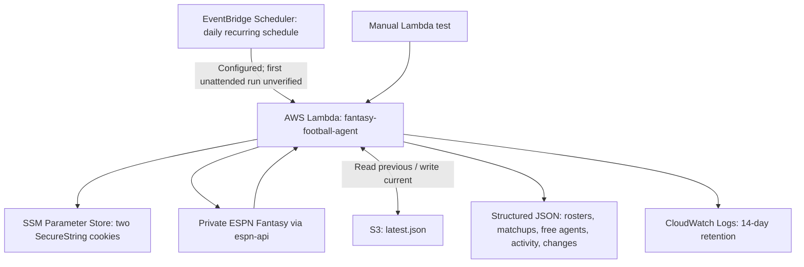

# Fantasy Football Data Pipeline — AWS Project Documentation

**Document status:** Living technical record — AWS foundation deployed; first unattended scheduled invocation not yet verified  
**Last updated:** November 8, 2026  
**Project:** Fantasy Football Agent — AWS Foundation  
**Purpose:** Preserve the implementation, decisions, verified outcomes, remaining work, and portfolio evidence needed for a Medium article, a public GitHub repository, and a separate future AI-agent project.

> **Privacy rule:** Never include ESPN authentication cookies, local `.env` contents, AWS access keys, unredacted account identifiers, or private league information in public screenshots, code, articles, or repositories. This document intentionally excludes secrets.

## 1. Executive summary

Built a working Python integration with a private ESPN Fantasy Football league using the community `espn-api` library. The application was developed and tested locally, deployed to AWS Lambda, authenticated securely using encrypted parameters in AWS Systems Manager Parameter Store, and verified to retrieve league rosters and weekly matchups. The Lambda function was then extended to write a JSON snapshot to an S3 bucket and compare the latest roster memberships against the previously stored snapshot.

**Verified end-to-end through manual Lambda tests:** Invocation succeeded with HTTP-style `statusCode: 200`; `latest.json` was created and later updated in S3; roster/matchup data, free agents, and recent transactions are present in the snapshot. A subsequent execution returned `"changes": []`, showing that comparison ran without detecting roster membership changes. Detection of a **real** roster addition or removal has not yet been demonstrated. An enabled daily schedule exists, but its **automatic invocation has not yet been verified**.

**Since the first draft:** EventBridge Scheduler was created and enabled; Lambda was expanded to collect free agents and league activity, both confirmed in S3; CloudWatch logs were verified; S3 security and the existing AWS Budget alert were reviewed; CloudWatch log retention was changed to 14 days. **Still pending:** verification of the first genuinely unattended EventBridge invocation, detection of a real roster change, final review of published artifacts and costs, Medium screenshots, and GitHub preparation. The autonomous AI reasoning and proactive notification features are **out of scope for this AWS-foundation project** and will be developed separately.

## 2. Architecture (deployed, with scheduling configured)



**Current behavior:** A successful manual invocation fetches ESPN data, compares team roster membership against S3's previous `latest.json`, overwrites it, and returns JSON. The EventBridge schedule is enabled and targets Lambda, but **successful unattended delivery remains to be demonstrated in CloudWatch and S3**. There is no AI inference or alert delivery in this AWS-foundation version.

## 3. Technology inventory

| Component | Purpose | Verified status |
|---|---|---|
| Windows + Visual Studio Code | Development environment | Installed and used |
| Python 3.12.10 | Application language | Verified locally |
| pip 25.0.1 | Python package management | Verified locally |
| Git 2.56.0.windows.4 | Version control | Installed; `git init` completed |
| Python virtual environment (`.venv`) | Dependency isolation | Created and activated |
| `espn-api` (installed version observed: 1.0.1) | Retrieve private league data | Local and Lambda tests succeeded |
| `python-dotenv` | Local environment-variable loading | Installed/used |
| `boto3` | AWS Parameter Store and S3 client | Used in Lambda |
| AWS Lambda, Python 3.12, x86_64 | Serverless execution | Deployed and tested |
| AWS Systems Manager Parameter Store | Store ESPN session cookies | Two SecureString parameters created |
| AWS IAM | Limit Lambda resource access | Two custom inline policies added |
| Amazon S3 | Persist latest league snapshot | Bucket and object verified |
| Amazon CloudWatch Logs | Lambda execution diagnostics | Lambda test logs visible |
| Amazon EventBridge Scheduler | Daily recurring invocation | Schedule created, enabled, target verified; first unattended run pending |
| OpenAI API / agent reasoning | Autonomous decision-making | Separate follow-on project; not configured |

## 4. Resource/configuration record

### AWS
- **Region:** `us-east-1` (N. Virginia)
- **Lambda function:** `fantasy-football-agent`
- **Runtime:** Python 3.12; architecture x86_64
- **Memory:** 256 MB
- **Timeout:** 60 seconds
- **Ephemeral storage:** 512 MB (default)
- **Lambda handler:** `lambda_function.lambda_handler`
- **Execution role:** AWS-created basic Lambda execution role, with additional narrowly scoped policies (role-specific suffix intentionally omitted here)
- **S3 bucket:** `fantasy-agent-snapshots-afofana`
- **S3 object key:** `latest.json`
- **EventBridge schedule:** `fantasy-agent-daily-check`; group `default`; enabled; recurring `rate(1 day)`; no end date; flexible time window off; target Lambda `fantasy-football-agent`; payload `{}`; AWS-created Scheduler execution role
- **CloudWatch log group:** `/aws/lambda/fantasy-football-agent`; retention **14 days**
- **AWS Budget:** existing **$0.10 monthly** budget; **80% ($0.08) actual-spend email alert** confirmed; no automatic shutdown; Cost Explorer previously showed $0, not reverified as a final bill
- **S3 protections configured:** Block Public Access enabled; ACLs disabled; versioning disabled; SSE-S3 default encryption; Object Lock disabled
- **SSM SecureString parameter names:** `/fantasy-agent/espn-s2` and `/fantasy-agent/espn-swid`
- **SSM key selection:** AWS-managed KMS key `alias/aws/ssm`

### IAM design
1. Existing Lambda basic execution policy permits CloudWatch logging.
2. Inline policy `FantasyAgentReadESPNParameters` permits `ssm:GetParameter` on only the two ESPN SecureString parameters.
3. Inline policy `FantasyAgentS3Snapshots` permits `s3:GetObject` and `s3:PutObject` on objects in the snapshot bucket. It was expanded with narrowly scoped `s3:ListBucket` access conditioned on the `latest.json` prefix to distinguish a missing first snapshot from an access error.

**Security note:** SecureString protects values at rest and IAM limits access; the session cookies still act like login credentials and must never be copied into logs or source control. Revisit credential rotation and permission boundaries prior to unattended production operation.

## 5. Local project layout

```text
fantasy-football-agent/
├── .env                        # Local secrets; NEVER commit or publish
├── .gitignore                  # Ignores .env, .venv, package/, ZIPs, etc.
├── .venv/                      # Local virtual environment
├── test_espn.py                # Local ESPN API proof of concept
├── lambda_function.py          # Current AWS Lambda application
├── package/                    # Bundled third-party dependencies
└── fantasy-agent-lambda.zip    # Uploaded deployment artifact
```

`.gitignore` verified to exclude `.env` via `git check-ignore .env`. **Before any public push, also verify that no secrets were ever staged or committed** and that the ZIP excludes `.env`.

## 6. Implementation milestones and verification

| Milestone | Evidence/result | Status |
|---|---|---|
| Install/configure VS Code, Python, pip, Git | Tools verified in PowerShell | Complete |
| Configure virtual environment and VS Code interpreter | `.venv` with Python 3.12.10 active | Complete |
| Authenticate to private ESPN league | League name and 10 team names displayed | Complete |
| Retrieve rosters | All 10 team rosters, player positions, lineup slots, injury designations displayed | Complete |
| Retrieve weekly matchups | ESPN fantasy week, matchups and projections displayed | Complete |
| Retrieve free agents | Up to 50 per position locally; expanded Lambda returned free-agent data in S3 | Complete for initial sampled pool |
| Retrieve recent league transactions | Local tests plus deployed S3 JSON; add/drop and trade-related activity visible | Complete for latest sampled activities |
| Convert connector output to JSON | Local Lambda-style script executed successfully | Complete |
| Package and upload to Lambda | ZIP deployment succeeded | Complete |
| Store credentials securely in SSM | Both parameters created; scoped read IAM policy | Complete |
| First cloud test | `statusCode: 200`; league data returned | Complete |
| Create S3 bucket and IAM access | Bucket created and S3 policy applied | Complete |
| Persist first snapshot in S3 | `latest.json` visible in S3 Objects tab | Complete |
| Read/compare subsequent snapshot | Response included `"changes": []` | Complete (no-change path only) |
| Demonstrate detection of a real add/drop | Needs a natural roster transaction | Not yet verified |
| Verify first unattended scheduled invocation | Need post-schedule CloudWatch START/END/REPORT and S3 last-modified confirmation | Pending |
| S3 security review | Block Public Access on; ACLs disabled; versioning off; SSE-S3; Object Lock off | Verified |
| EventBridge automated schedule | Enabled `fantasy-agent-daily-check` targets the correct Lambda with `{}` payload | Configured; automatic run unverified |
| Waiver/transaction collection inside deployed Lambda | `free_agents` and `transactions` keys verified in S3 `latest.json` | Complete for initial data schema |
| Injury/lineup-status change detection | Current comparison uses player names on team rosters | Pending |
| Billing alarms and CloudWatch monitoring | $0.10 AWS Budget with 80% actual email alert; CloudWatch logging working; 14-day retention | Configured/verified, not a hard cap |

### Observed Lambda test performance
- **First cloud ESPN test:** ~8.87 seconds, ~137 MB memory used, 256 MB configured.
- **Subsequent S3-enabled test:** ~9.98 seconds, ~142 MB memory used, 256 MB configured.
- **Expanded free-agent and activity Lambda test:** ~20.28 seconds, ~142 MB used, 256 MB configured; returned successfully and updated `latest.json`.
- CloudWatch logs for this ~20-second run were inspected; it was a **manual** test, not evidence of scheduled invocation.
- Treat these as **single observed runs**, not a benchmark or guaranteed latency.

## 7. Implementation logic (current)

`get_espn_credentials()` loads local `.env` during development; in Lambda, it uses `boto3` SSM `GetParameter(WithDecryption=True)` for the two stored cookie values.

`lambda_handler()` constructs an `espn_api.football.League` object, retrieves all teams and their rosters, and retrieves matchups for `league.current_week`, retrieves up to 50 free agents per QB/RB/WR/TE/D/ST position, and iterates over the most recent 20 activity records. It creates JSON with league name, week, retrieval timestamp, teams, matchup projections, a `free_agents` dictionary, and `transactions` records.

`save_snapshot(data)` reads `latest.json` if present, builds per-team sets of **player names**, reports additions/drops by comparing the previous and current membership sets, and writes the current snapshot back to S3. A fresh bucket starts with no previous snapshot; on subsequent runs, `changes` should be empty when no membership changed.

**Current limitations to address:**
- The comparison uses player names rather than stable player IDs; names may collide or change.
- It detects roster membership changes but not lineup-position, injury designation, or projection changes.
- Free agents are sampled at up to 50 per position, **not guaranteed to be the exhaustive waiver pool**. Activity is limited to the latest 20 records; transaction completeness, details, and de-duplication require future work.
- Trade-related actions (`TRADE_SENT` / `TRADE_RECEIVED`) were visible in JSON, but this does not prove access to all trade negotiations or complete trade state.
- Overwriting `latest.json` means there is no durable historical timeline of snapshots. Versioning is off.
- A single `latest.json` works for an initial prototype but needs coordination/idempotency if overlapping invocations become possible.
- ESPN endpoints are unofficial and could change or limit requests.
- The first successful `changes: []` test proves the no-change comparison path, not correctness for actual transactions.

## 8. Engineering decisions and why they matter

| Choice | Rationale | Trade-off |
|---|---|---|
| AWS Lambda instead of always-on EC2 | Event-driven, no idle compute charges, portfolio-relevant | Execution limits; packaging and IAM considerations |
| Python `espn-api` community library | Avoid building ESPN endpoint client from scratch | Unofficial integration; may break if ESPN changes |
| SecureString in Parameter Store | Avoid hardcoded cookies in code/ZIP; scoped IAM reads | Cookies still need rotation and careful access |
| Least-privilege inline IAM policies | Keep SSM and S3 access narrowly scoped | Requires precise ARN/resource handling |
| S3 `latest.json` | Inexpensive and simple persistent state | No history unless design is expanded |
| JSON output | Portable structured input for future analysis and AI | Need schemas/versioning as data expands |
| Manual tests before scheduling | Validate connectivity/storage before unattended use | Schedule now configured; first unattended result pending |
| Daily EventBridge schedule | Cost-conscious cadence, low ESPN polling frequency | Misses time-sensitive moves between daily checks; can be adjusted later |
| 14-day CloudWatch retention | Keep useful troubleshooting history without indefinite log growth | Older log events expire |
| Existing $0.10 budget alert | Detect unexpected charges early | Alert threshold is $0.08; does not stop spending or guarantee near-real-time billing |
| Separate AI-agent project | Portfolio story focused on cloud ingestion pipeline | Autonomous intelligence not yet delivered |

## 9. Troubleshooting and learnings

- Windows had no usable `python` command initially; installed Python 3.12 and used the `py` launcher before configuring the virtual environment.
- PowerShell blocked virtual environment activation; a process-scoped execution policy setting enabled activation without permanently changing the system-wide setting.
- VS Code Python extension/interpreter selection required setup; configured interpreter inside `.venv`.
- Git was not installed initially; installed Git, initialized the repository, and verified `.env` was ignored.
- AWS Lambda UI had different navigation than older walkthroughs; uploaded deployment ZIP via the Code source controls.
- S3 missing-object handling required checking the role's ability to distinguish an absent `latest.json` object from denied access; added narrowly scoped `ListBucket` permission rather than suppressing all `AccessDenied` errors.
- Kept ZIP builds repeatable by copying updated `lambda_function.py` into `package/` and running `Compress-Archive`; verified the archive contained application code and dependencies.

## 10. Remaining AWS scope — practical completion checklist

- [x] Create and enable EventBridge Scheduler with Lambda target, `rate(1 day)`, `{}` payload.
- [x] Expand deployed Lambda JSON to include sampled free agents and recent league activities.
- [x] Verify CloudWatch Lambda logging and set **14-day retention**.
- [x] Confirm existing $0.10 AWS Budget and 80% **Actual** threshold with email notification.
- [x] Verify S3 security: private, SSE-S3, no versioning or Object Lock.
- [ ] **Confirm first truly automatic scheduled run**: compare CloudWatch invocation timestamp and S3 `latest.json` last-modified timestamp with the manual-test period; don't infer automation from an enabled schedule alone.
- [ ] Recheck Cost Explorer after a scheduled run; AWS billing information can lag.
- [ ] Confirm no secrets in deployment ZIP, files to publish, or Git history; `.gitignore` alone does not erase prior tracked secrets.
- [ ] Verify the actual add/drop detection path when a genuine transaction occurs (no need to change your fantasy roster just to manufacture a test).
- [ ] Consider stable player identifiers, injury and lineup change tracking, failure alerts, and idempotency as scoped improvements rather than claiming they're already implemented.
- [ ] Decide whether to retain historical snapshots; the current single-object overwrite generates no S3 object history.
- [ ] Capture sanitized screenshots, finalize GitHub README and Medium article after scheduled-run evidence arrives.

## 11. Medium article plan and screenshot checklist

**Working article angle:** *Building a Serverless ESPN Fantasy Football Data Pipeline with Python and AWS Lambda*.

Suggested narrative: a real personal problem (manually checking fantasy changes), the engineering solution, architecture, secure handling of private session credentials, serverless execution, state persistence, troubleshooting, what was verified, costs, and future extension to AI.

Capture **real project screenshots later**, without rebuilding resources:

- [ ] VS Code project tree and relevant, non-secret Python code.
- [ ] Local test results showing league data, with team/league names redacted as desired.
- [ ] Lambda function overview (runtime, memory, timeout; redact account identifiers).
- [ ] Parameter Store **names/types only**, never decrypted values.
- [ ] IAM role and **redacted** inline policy showing least-privilege SSM/S3 permissions.
- [ ] S3 Objects view displaying `latest.json` (do not expose full private data publicly).
- [ ] Lambda successful Test result, invocation duration and memory usage.
- [ ] CloudWatch log group with successful invocation details and safe fields.
- [ ] EventBridge Scheduler configuration (already created) **and** evidence of successful unattended run (still pending).
- [ ] Final high-level architecture diagram; author manually if desired rather than using AI-generated visuals.

**Writing approach:** Describe decisions in an authentic first-person voice; avoid buzzwords and exaggerated claims such as “production-grade” or “fully autonomous” before verifying those attributes. Explain the *why*, not just the click path.

## 12. GitHub deliverable plan

Suggested public repository contents:

```text
README.md
lambda_function.py
requirements.txt
.gitignore
.env.example              # placeholder names only; no credential values
architecture/              # optional manually authored diagram
screenshots/               # sanitized images only
```

README sections: project overview, architecture, capabilities, prerequisites, safe local setup, AWS services, deployment overview, validation evidence, costs, limitations, and roadmap.

**Before publishing:** Review commits/ZIP/files for credentials, redact private league information, avoid committing session cookies or live parameter values, and consider moving resource identifiers to environment variables for easier reuse.

## 13. Future AI-agent project handoff (separate conversation)

**Starting assets:** Working private ESPN retrieval using Python, Lambda deployment, Parameter Store credentials, S3 snapshot storage, basic change detection, sampled free-agent and transaction feeds, and a configured (not yet end-to-end verified) daily EventBridge schedule.

**Agent objective:** Operate proactively and independently, not merely answer prompts. Periodically examine league changes, consult credible NFL injury/news context, apply PPR lineup/waiver/opponent decision rules, distinguish verified facts from estimates, and notify only when action is meaningful.

**Future work:** Build on the already deployed sampled free-agent/transaction payloads; expand coverage where needed; add news/injury feeds; change significance rules; AI model/API invocation; notification delivery; controlled conversational access; cost and invocation ceilings; quality and reliability testing. ChatGPT Plus and OpenAI API billing are separate; agent API costs require explicit budget controls. This AWS project alone is **not yet an autonomous AI agent**.

## 14. Maintenance and handoff procedure

After each new milestone, update: **(a)** resource/configuration record, **(b)** verified outcomes, **(c)** known limitations, **(d)** screenshot opportunities, **(e)** next steps. Keep this file as the canonical project narrative, not the chat history. When ready, use it to produce the Medium draft and GitHub README. The user can re-upload this Markdown file in a new conversation to restore the project context.

---

**Next immediate action:** Verify the first unattended EventBridge invocation, then audit and finalize the public portfolio artifacts.

## 15. Latest progress update — November 8, 2026

- EventBridge Scheduler was created and confirmed **Enabled**; target tab showed the intended Lambda function and empty `{}` payload. The schedule repeats every day and has no end date. Disable it after the fantasy season if it is no longer needed.
- Lambda was redeployed with free-agent and transaction collection. The observed manual invocation succeeded and took ~20.28 seconds with ~142 MB of memory used. The resulting S3 snapshot was inspected and contained both `free_agents` and `transactions` fields, including trade-related activity.
- CloudWatch logs were inspected for a manual invocation. A later setting change established **14-day log retention**. **No automatic EventBridge-triggered invocation has been conclusively verified as of this update.**
- S3 security was reviewed: Block Public Access enabled, ACLs disabled, bucket versioning disabled, SSE-S3 encryption, and Object Lock disabled.
- The AWS Budget remained at $0.10/month, with an 80% ($0.08) actual-cost email alert. This **does not impose a spending cap**.
- The AI model integration, autonomous reasoning, proactive notifications, and conversational interface remain a **separate follow-on implementation**, not part of the completed infrastructure claims.

### Continuation checkpoint

**Next verification:** After the daily schedule has had time to execute, open CloudWatch `/aws/lambda/fantasy-football-agent` and inspect the latest invocation. Compare its timestamp to manual tests, then confirm `latest.json` was updated in S3. Only then mark unattended execution verified. Following that, audit code and secrets for GitHub, capture authentic redacted screenshots, and produce the Medium article.
