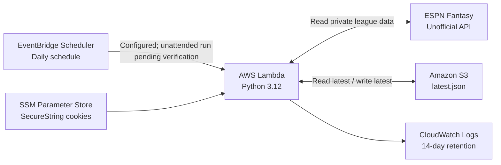

# Serverless ESPN Fantasy Football Data Pipeline

A Python application that retrieves data from a private ESPN Fantasy Football league and stores a structured snapshot in Amazon S3. AWS Lambda runs the integration, AWS Systems Manager Parameter Store secures ESPN session credentials, and Amazon EventBridge Scheduler is configured to invoke the function daily.

**Project status:** Manual cloud executions, S3 writes, and the no-change comparison path have been verified. The first *unattended* scheduled execution and detection of a real add/drop are **not yet verified**. Autonomous AI recommendations are a separate future phase, not part of this project.

## Architecture



## What it does

- Retrieves team rosters, player positions, lineup slots, and injury designations.
- Retrieves weekly matchups and projected matchup scores.
- Collects a **sample** of free agents (up to 50 per position) and recent league transactions (up to 20 activity records).
- Serializes the results as JSON and overwrites `latest.json` in S3 on each run.
- Compares current roster membership against the previous snapshot and reports additions or removals by player name.
- Uses encrypted Parameter Store values rather than embedding ESPN session cookies in the Lambda deployment.

**Limitations:** The current version does not search the entire waiver pool, detect injury or lineup-status changes, generate AI recommendations, or deliver notifications. It maintains only the most recent snapshot rather than a full historical record. The ESPN API is unofficial and can change without notice.

## AWS services and design choices

| Service | Role |
|---|---|
| AWS Lambda | Runs Python ingestion and roster comparison without a managed server |
| EventBridge Scheduler | Enabled, configured with `rate(1 day)` and an empty `{}` event |
| Amazon S3 | Private, SSE-S3 encrypted storage for `latest.json` |
| Systems Manager Parameter Store | Stores `espn_s2` and `SWID` as SecureString parameters |
| AWS IAM | Limits Lambda to reading two parameters and reading/writing its designated S3 snapshot |
| CloudWatch Logs | Execution logging, 14-day retention |
| AWS Budgets | Actual-spend email alert; notification only, **not** a spending cap |

Lambda is configured for Python 3.12, x86_64, 256 MB memory, and a 60-second timeout. Its S3 bucket blocks public access. The scheduler uses a separate execution role from the Lambda runtime role.

## Verification results

| Test | Result |
|---|---|
| Private ESPN authentication | Success locally and in Lambda |
| League roster and matchup retrieval | Success |
| Free-agent and transaction data in S3 | Verified |
| S3 `latest.json` creation and update | Verified |
| Repeat-run comparison with no roster changes | Returned `"changes": []` |
| CloudWatch execution logs | Verified |
| EventBridge enabled with correct Lambda target | Verified configuration |
| First unattended scheduled execution | **Pending verification** |
| Actual roster add/drop detection | **Pending verification** |

The expanded Lambda execution completed in approximately **20.28 seconds** and used approximately **142 MB** of its 256 MB allocation in the observed test. These are test observations, not performance guarantees.

## Repository contents

```text
.
├── lambda_function.py    # Lambda handler, ESPN retrieval, S3 snapshot logic
├── test_espn.py         # Local connectivity/proof-of-concept script
├── README.md            # Public-facing project overview
└── .gitignore           # Excludes local secrets, dependencies and build artifacts
```

Local-only items such as `.env`, `.venv/`, `package/`, and deployment ZIPs **must not be committed**. A detailed internal project record can be kept separately; review it for account IDs, league names, and other identifying details before publishing.

## Running locally

The project was developed on Windows using VS Code and Python 3.12. The local test uses the community [`espn-api`](https://github.com/cwendt94/espn-api) library.

1. Create a virtual environment and activate it.
2. Install dependencies: `python -m pip install espn-api python-dotenv boto3`.
3. Create a local `.env` file (never commit it) containing `ESPN_LEAGUE_ID`, `ESPN_YEAR`, `ESPN_SWID`, and `ESPN_S2`.
4. Run `python test_espn.py` to test ESPN access without AWS.

**Caution:** The Lambda handler is designed to save snapshots to S3 when invoked. Running `lambda_function.py` locally also invokes that handler, so don't use it as a harmless offline test without adjusting the storage behavior. The deployed Lambda expects IAM permissions and its Parameter Store secrets.

ESPN session cookies are account credentials. Never post them, add them to logs, or upload them to a repository. Private leagues require authorization, and use of unofficial endpoints is subject to change.

## Next steps

- Verify an unattended EventBridge invocation against CloudWatch and S3's object timestamp.
- Validate a genuine roster-addition/removal event without manipulating the league for testing.
- Consider reducing the JSON response size and making configuration values environment-driven.
- Capture authentic, redacted AWS and VS Code screenshots for the accompanying Medium article.
- Build autonomous AI analysis and notifications as a **separate follow-on project**.

## Portfolio context

This project demonstrates serverless execution, external API integration, structured data processing, secure parameter retrieval, least-privilege IAM, persistent cloud storage, and cost-aware operational monitoring. It is an AWS data pipeline—not yet a completed AI agent.
